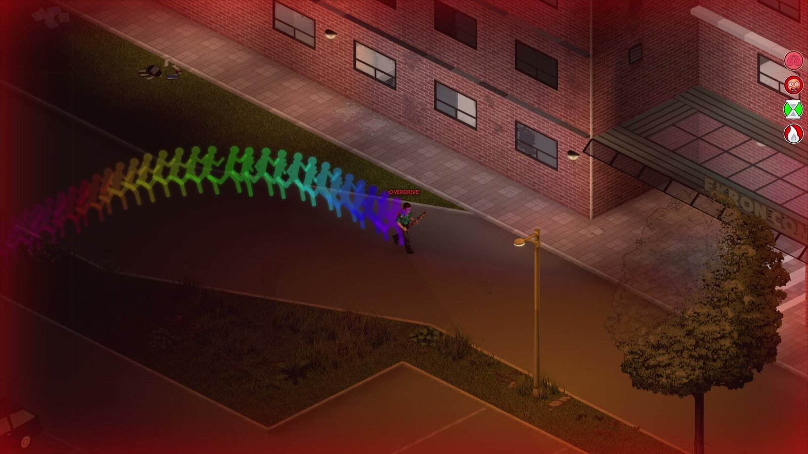
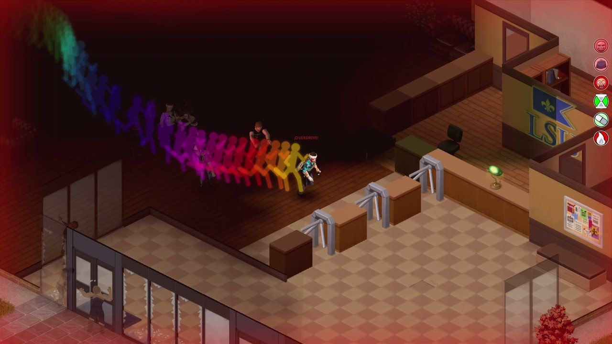

# Sandevistan for Project Zomboid (Build 42)

[Español](README.es.md) · [Steam Workshop](https://steamcommunity.com/sharedfiles/filedetails/?id=3816048725) ·
[Player guide](docs/guide/README.md) · [How it works](docs/how-it-works/README.md) · [Changelog](CHANGELOG.md)

A mod that adds the **Sandevistan** spinal implant from *Cyberpunk 2077 / Edgerunners* as a risk-reward system: you slow time
down for the rest of the world, and you pay for it with heat, implant rejection, neural load and, if you push it, cyberpsychosis.
There is no magic cure: the body is the weak link, not the chip.

- **Download:** the [Steam Workshop (3816048725)](https://steamcommunity.com/sharedfiles/filedetails/?id=3816048725) is the only
  way to get the playable mod.
- **Version:** 0.8 (build 201) · Project Zomboid Build 42 (tested on 42.21, `versionMin=42.20`)
- **Languages:** English, Latin American Spanish, Rioplatense Spanish and Russian

## What the mod does

- **Time dilation.** Switch the implant on and the zombies around you move, turn, attack and fall in slow motion while you run,
  hit, reload and climb faster, leaving afterimages behind.
- **Heat and Overdrive.** Heat rises while it's on and cuts it off at the top. Arm the Overdrive for a window of extra power that
  always ends in a collapse.
- **Your body pays.** Rejection, immunosuppressants and their downside, neural load, and stamina you borrow while it's on.
- **Cyberpsychosis.** Above a threshold of neural load the mind starts to break: danger sense, phantom marks, corrupted text,
  fake zombies, your own double, blackouts, fury. There is a way back, and it's long.
- **Surgery and crafting.** Install, explant, extract from bodies, calibrate, and build your own replica from five parts.
- **Firmware.** Two slots and nine programs that change how the implant behaves, each with a cost somewhere else.
- **A world to search.** Lab prototypes on two campuses, ex-subjects wearing implants, a military base with the best ones, and
  lore notes that tell what happened there.
- **Multiplayer.** Works in hosted games and on dedicated servers, including surgery on another player.

| | |
|---|---|
|  |  |
| Afterimages while dilating time | The Prototype 05 panel: Heat, rejection, neural load |
|  |  |
| Cyberpsychosis | Afterimages in Viewpoint's 3D camera (optional add-on) |

## What this repository is

This is the public home of the mod's **documentation and source code**: people can read how it works, check what it does to a
save or a server, and learn from the code. It contains:

| Folder | What |
|---|---|
| [`docs/guide/`](docs/guide/README.md) | The **player guide** (English, Spanish and Russian): every system, the numbers, and where to find everything (spoilers marked). |
| [`docs/how-it-works/`](docs/how-it-works/README.md) | **How it works inside**: where each piece of code runs, what is saved where, the life of an activation, multiplayer, the Java add-ons. |
| `mod/` | The four mods' Lua, item and recipe scripts, sandbox options, `mod.info` and translations, exactly as published on the Workshop. |
| `java/` | Java source of the three optional add-ons (they load through ZombieBuddy). |
| [`CHANGELOG.md`](CHANGELOG.md) | What changed in the latest update. |

What it does **not** contain (apart from the screenshots in `docs/img/`): models, textures, icons, sounds, the compiled `.jar` files and the animation sets (those are
derived from vanilla files). So `mod/` is not a playable copy: install the mod from the Workshop.

Development happens elsewhere and this repository is generated from it on each release, so it isn't edited by hand. Code comments
are in Spanish and sometimes mention internal design notes that aren't published here.

## Installing

From the Workshop: subscribe, then enable **Sandevistan** in the Mods screen before creating the game or the server.

- **Optional:** [Moodle Framework](https://steamcommunity.com/workshop/filedetails/?id=3396446795) shows the mod's states as moodles.
  Without it everything works the same and the states show in the floating panel.
- **Optional Java add-ons** (enable them next to the base mod): *Slow sound and frozen rain* (`SandevistanFX`), *Cyberpsychosis
  hallucinations* (`SandevistanPsychosis`) and *Afterimages with real pose* (`SandevistanViewpoint`). All three need
  [ZombieBuddy (3619862853)](https://steamcommunity.com/sharedfiles/filedetails/?id=3619862853). **Approve their jars when the
  game starts**, not after loading a game with Viewpoint (that closes the game).
  [Viewpoint (3809306528)](https://steamcommunity.com/sharedfiles/filedetails/?id=3809306528) is optional for the 3D camera.
- **Dedicated server:** only `Sandevistan` is needed; the add-ons are client-side. If the server enables them without ZombieBuddy,
  they don't load and the base mod keeps working.

## Reporting a problem

Please report bugs in the **comments of the Workshop page**, with:
- the mod version (it's at the top of the report),
- single player, hosted game or dedicated server,
- the file `Zomboid/Lua/Sandevistan_report.txt` (enable the debug menu in the mod options, then *Debug → Tests and reports →
  Quick REPORT*) and, if there are errors, `Zomboid/console.txt`.

Issues are turned off on this repository and pull requests are not accepted: the code here is generated from the development
repository on each release.

## License

- **Code** (Lua and Java in `mod/` and `java/`): [MIT](LICENSE).
- **Documentation** and the mod's **own assets**: [CC BY-NC-SA 4.0](LICENSE-docs.md).
- Project Zomboid belongs to The Indie Stone; third-party material keeps its own license. See [NOTICE](NOTICE.md) and
  [CREDITS](CREDITS.md).
