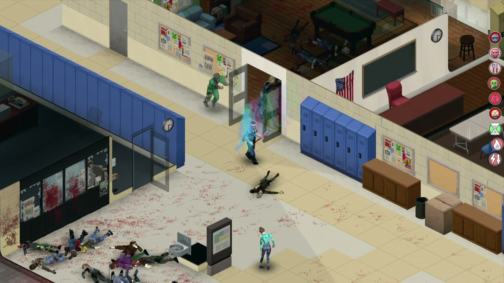
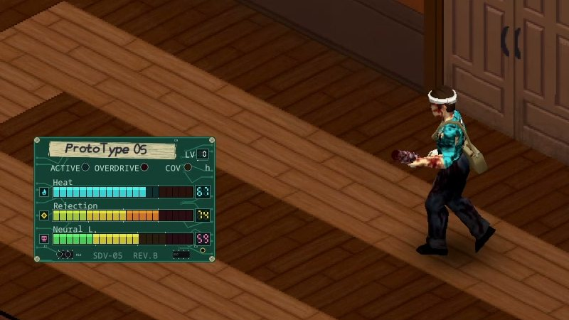
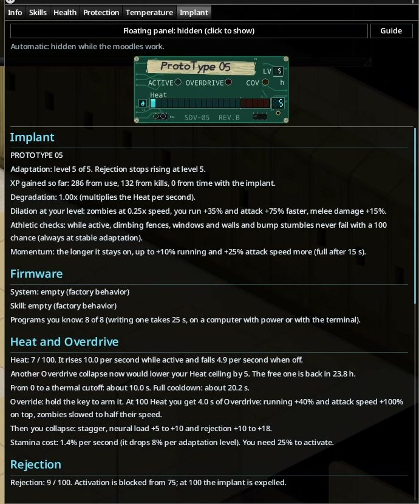

# Using the implant

[Back to contents](README.md) · [Español](../es/using-the-implant.md)

## Controls

| Action | How |
|---|---|
| Switch on | Tap **Z** (change it in *Options → Mods → Sandevistan*). You need at least a quarter of your stamina. |
| Switch off | Tap Z again. This is free: Heat stays where it is, and you can switch on again after 1 second. |
| Arm the Overdrive | While it is on, **hold** Z for a moment. When the Heat bar fills, you enter Overdrive instead of a thermal cutout. |
| End the Overdrive early | Tap Z during the Overdrive. You collapse right away. |
| Show / hide the floating panel | A second key in the mod options (unassigned by default). |
| Force the implant | With it **off**, **hold** Z for 0.8 s when the only thing stopping you is **stamina** or **heat** (the usual messages). It goes straight into Overdrive. |
| Disconnect / reconnect | In the implant menu (**Disconnect the implant** / **Reconnect the implant**). Only with the implant **off** and no fury. |

With cyberpsychosis the implant gets harder to control: arming needs a double tap and then a hold, and switching off responds
with a short delay.

**Forcing** always ends in a collapse and you pay for it:

- **No air:** your stamina drops to 0, you get fatigue and you can't sprint for 10 s. You can't force it again until you're back at
  **half** your stamina.
- **Stuck from heat:** you get a **burn** on your lower back, the implant wears **+0.1×** and you keep a **thermal scar** even if the
  collapse of the day would have been free. You can't force it again until the Heat is back to **0**.

There is no fixed waiting time: the block lifts by itself when you recover. Forcing is only for emergencies, and it can also be
turned off in the sandbox.

### Disconnecting the implant

You can **disconnect** the implant from its menu (only with it **off** and without the fury). While it is disconnected it is inert:

- it cannot be switched on and the firmware does not run;
- **neural load falls at half speed** and **remission advances at half speed**;
- brain-damage symptoms keep going at **half strength** (×0.25 with antidepressants): hallucinations, blackouts, night terrors,
  screams, nosebleeds;
- what the implant does disappears: neural monitor messages, threat marks and the screen glitch. The panel reads **DISCONNECTED**.

**Reconnecting** costs **+8 neural load**, **20 seconds** without being able to switch it on, some stress and a short glitch; if you
reconnect within **10 minutes** the neural load costs **double**. Reconnecting also resets remission.

## Time dilation

*Time dilation on: the afterimages trail behind you while the zombies around you move in slow motion.*

While the implant is on, zombies within **16 tiles** (sandbox option) move, turn, attack, fall and get up in slow motion. You
move faster and attack faster. How strong it is depends on your adaptation level and on the implant:

| Tier | Adaptation level | Zombie speed | Your movement | Your attack speed | Implants |
|---|---|---|---|---|---|
| I | 0 to 4 | 30 % | +25 % | +50 % | all |
| II | 5 to 7 | 25 % | +35 % | +75 % | all |
| III | 8 and up | 20 % | +40 % | +100 % | military only |
| IV | mastery 15 | 18 % | +45 % | +110 % | military, with the Beyond Ten mod |

Lab implants stop at tier II, because their adaptation caps at level 5.

Other effects while it is on:

- **Momentum:** the longer you keep it on without stopping, the more you gain, up to +10 % movement and +25 % attack after about 15 seconds.
  The extra fades over about a minute once you switch off.
- **Melee:** the implant multiplies the damage each hit does, adjusted per weapon (light weapons gain more, heavy ones less). With
  Strength 5 and weapon level 0, a baseball bat kills a zombie in about 3 hits. You also get +15 % critical chance, +15 %
  knockdown chance and 30 % of each swing's stamina back. Attack speed is capped at 2.5×, and any speed above the cap becomes extra
  damage instead.
- **Firearms:** reloading, racking and swapping magazines get as much faster as your movement does (sandbox option).
- **Faster animations:** walking, running, climbing fences, walls and windows, and ropes. While it is on, climbs and bump stumbles
  can't fail with a chance equal to your adaptation. At stable adaptation they never fail.
- **Afterimages:** a trail of tinted silhouettes behind you: cyan for lab, amber for military, red with cyberpsychosis. There is a
  rainbow option in the mod options.
- **Stamina debt:** while the implant is on, your endurance **does not drop**. What you spend is charged when you switch it off:
  running, sprinting, hitting, pushing, climbing and the implant's own drain all go on a tab. If the tab goes more than 35 %
  past what you had when you switched on, the implant cuts itself off and you get a stagger and no sprint for 2 to 5 seconds.
  The **Borrowed breath** moodle shows how deep you are. The sandbox option *Deferred stamina* (Off / Normal / Gentle) turns it off or
  leaves only the bill.

In multiplayer, other players inside the bubble are slowed too (admins never are).

## Heat

Heat rises every second the implant is on and falls when it is off.

- At **100** the implant cuts out by itself (a **thermal cutout**). You stagger for a second and the implant stays **locked** until
  Heat falls back to 0. A thermal cutout adds 2 to 4 rejection, and nothing once your adaptation is stable.
- Rough times from 0 to a cutout: lab level 0 about **6 s**, lab level 5 about **10 s**, military level 0 about **8 s**, military
  level 10 about **18 s**.
- Cooling from full: lab level 0 about 30 s, lab level 5 about 20 s, military level 10 about 12 s.
- **Ambient cooling:** cold, wet clothes and the wind outdoors cool the implant up to **×1.45** faster (×1.9 on *Strong*). The same
  bonus makes the Heat bar fill a little slower while it is on (about ×1.15 at full bonus), so the burst lasts longer. It only ever
  helps: heat never makes it worse. Using the implant dries you. Sandbox option: *Ambient cooling* (Off / Normal / Strong).
- Heat rises faster when the implant is worn (see [Wear](#wear-and-calibration)), with high neural load, with the Edgerunner trait
  and right after you change firmware. It rises slower under Black Lace.
- A sound warns you at 80 Heat.

## Overdrive

Overdrive is a burst past the limit. Arm it by holding the key while the implant is on. When Heat reaches 100 you get:

- a window of **2.5 s** at level 0, rising to **4 s** (lab at level 5) or **7 s** (military at level 10);
- on top of your tier: +40 % movement, +100 % attack speed, zombies at half the speed they already had, +50 % melee damage.

It **always ends in a collapse**:

- you stagger, crawl for a couple of seconds, run a fever (38.5–39.5 °C) and take damage and pain in the torso;
- +5 to 10 neural load and +10 to 18 rejection (half at stable adaptation);
- a noise that draws nearby zombies;
- a **thermal scar**: your maximum Heat drops by 5 (the first collapse of each in-game day is free). It recovers 1 point per hour
  with the implant off, faster asleep. A "total fury" (see [cyberpsychosis](your-body.md#cyberpsychosis)) costs 15. The cap never
  drops below 50.

With cyberpsychosis an Overdrive collapse has a **1 % chance to kill you** and a 20 % chance of a deep chest cut. Under Black Lace
it also knocks you out for 5–10 seconds and hits your heart.

## Adaptation

**Sandevistan Adaptation** is a skill. It levels up while the implant is installed:

- 2 XP per second of use;
- 12 XP per zombie killed with it on;
- 5 XP per in-game hour, just from carrying it, while rejection is under 50.

Levels unlock stronger tiers, less Heat, faster cooling, a longer Overdrive window, more afterimages, fewer failed climbs and less
neural load per use (down to −25 %). Hover over a level square in the Skills tab to see exactly what each level gives.

**Stable adaptation** is level 5 for lab implants and level 7 for military ones. It matters a lot: from then on the implant **stops
raising rejection by itself** (see [Rejection](your-body.md#rejection)).

**Mastery:** with the **Beyond Ten** mod, military implants keep improving from level 11 to 15. Each level shaves Heat, stamina and
neural load, and adds Overdrive time. Level 15 unlocks tier IV.

Your adaptation stays with **you**, not with the implant. If you swap implants you keep all of it (half if the old one was
destroyed).

## The implants

| | Lab (Prototype 05 / 06) | Military (XM-1 / Mk. II) |
|---|---|---|
| Max adaptation | 5 | 10 (15 with Beyond Ten) |
| Best tier | II | III (IV with mastery) |
| Overdrive window at max level | 4 s | 7 s |
| Neural load per use | ×0.7 | ×1.0 |
| Base Heat | higher | lower |

Lab implants are easier to live with. Military ones are stronger but cost more neural load. Prototype 04 is a defective lab unit
that you can repair (see [Repairing a Prototype 04](surgery-and-crafting.md#repairing-a-prototype-04)).

## Wear and calibration

Each implant has a **wear** value: a Heat multiplier, where 1.0× is perfect. A rough extraction, a failed surgery or a study adds
wear. The item tooltip shows it. A worn implant can be **calibrated** back to 1.0× (see
[Calibration](surgery-and-crafting.md#calibration)), loose or installed. A repaired Prototype 04 can't go below 1.2×.

## The HUD

*The floating panel of the Prototype 05: Heat, rejection and neural load.*

*The Implant tab in the character window (captured on an earlier build; some numbers have changed).*

- **Floating panel:** Heat, neural load, rejection, coverage and adaptation. It fades when you are not using the implant. It looks
  different per implant: a circuit board for lab, carbon fiber for the XM-1, engraved aluminum for the Mk. II. You can scale it in
  the mod options.
- **Implant tab** in the character window: every number, what is raising or lowering it, how long until it wears off, your
  firmware and a button for the field guide.
- **Moodles** (with Moodle Framework): Heat, lockout, rejection, neural load, cyberpsychosis, herbal toxicity, immunodepression,
  Black Lace and its comedown, coverage, antidepressants, withdrawal and recovery, recalibration. Heat, neural load, rejection and
  immunodepression change their icon with each level.
- **The implant on your back:** a 3D model that lights up when it is on and turns red in Overdrive. Jackets and coats hide it.
