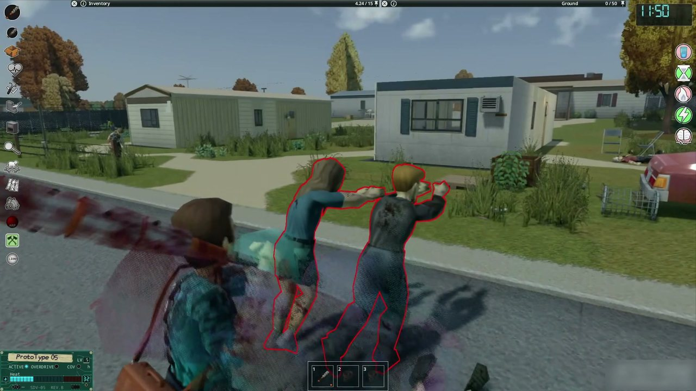

# Rasgos, opciones y complementos

[Volver al contenido](README.md) · [English](../en/settings.md) · [Русский](../ru/settings.md)

## Rasgos de personaje

| Rasgo | Puntos | Efecto |
|---|---|---|
| Eres especial | cuesta 7 | +1 nivel de adaptación y un 25 % más de XP de adaptación. |
| Instalador de callejón | cuesta 10 | Empiezas con un Prototipo 05, un arnés aplicador, un inmunosupresor casero (3 dosis), dos agujas de sutura y toallitas con alcohol. |
| Cromado | cuesta 12 | Empiezas con un implante de laboratorio **ya instalado** (desgaste 1,1×, rechazo 15), 24 h de inmunosupresor casero corriendo, un pack de 3 dosis y la guía de campo. No se puede combinar con Instalador de callejón. |
| Aprendiz de ripperdoc | cuesta 7 | Conoces las tres recetas civiles (compuesto sintético, inmunosupresor casero y tintura herbal) y empiezas con los libros de Primeros Auxilios y de Electricidad, vol. 1. +1 en Primeros Auxilios y +1 en Electricidad. |
| Edgerunner | cuesta 4 | Con el implante encendido: +10 % de movimiento y +15 % de ataque. El Heat sube un 25 % más rápido y los cortes y colapsos cuestan un 50 % más de rechazo. |
| Ex-corpo | cuesta 4 | Sabes la receta del Black Lace casero y empiezas con uno. |
| Neuralmente inestable | da 4 | La carga neuronal baja un 30 % más lento en reposo. |
| Propenso a la ciberpsicosis | da 5 | La carga neuronal sube un 25 % más rápido. |
| Rechazo al cromo | da 6 | El rechazo sube un 50 % más rápido. |

Rasgos del juego que importan: **Resistente** y **Propenso a enfermedades** (inmunodepresión), **Sanación rápida** y **Sanación lenta**
(la curación con inmunodepresión) y **Herbolario** (la receta de la tintura herbal).

## Dificultades

La opción de sandbox **Dificultad** elige un conjunto armado. Cualquier opción distinta de *Personalizada* reemplaza las opciones sueltas.

| | Arcade | Relajada | Normal | Realista | Brutal |
|---|---|---|---|---|---|
| Rechazo | ×0,4 | ×0,7 | ×1 | ×1,3 | ×2 |
| Velocidad del Heat | ×0,7 | ×0,85 | ×1 | ×1,1 | ×1,25 |
| XP de adaptación | ×2 | ×1,5 | ×1 | ×0,8 | ×0,6 |
| Duración de los inmunosupresores | ×1,5 | ×1,25 | ×1 | ×0,85 | ×0,7 |
| Inmunodepresión | apagada | Normal | Normal | Normal | Dura |
| Muerte en Overdrive (cyberpsicosis) | 0 | 0,5 % | 1 % | 3 % | 8 % |
| Remisión de la cyberpsicosis | sí | sí | sí | sí | **no** |
| Cicatriz térmica | no | sí | sí | sí | sí |
| Inmunosupresor casero conocido | sí | sí | no | no | no |
| Partes del Prototipo 06 en el botín | ×2 | ×1,5 | ×1 | ×0,7 | ×0,4 |
| Estuches criogénicos en la base | 2 | 2 | 2 | 1 | 1 |
| Mk. II fabricable | sí | sí | sí | sí | no |
| Todo el firmware conocido | sí | no | no | no | no |
| Síntomas de cyberpsicosis | solo el sentido de peligro | todos menos apagones y reflejo descontrolado | todos | todos | todos |

## Opciones de sandbox

Están todas bajo **Sandevistan** en las opciones de sandbox. Las que conviene conocer:

- **Generales:** rasgos en la creación de personaje, guía de campo con el primer implante, recarga más rápida, firmware encendido o
  apagado, radio de la dilatación (8 a 30 tiles, 16 por defecto), animaciones de zombis en cámara lenta, animaciones rápidas del
  jugador.
- **Balance:** velocidad del Heat, rechazo, XP de adaptación, duración de los inmunosupresores, inmunodepresión (Apagada / Leve / Normal
  / Dura), paliativos (pastillas), forzar el implante, abstinencia leve, probabilidad de herida en el pecho y de muerte en Overdrive, cicatriz térmica, remisión.
- **Mundo:** qué campus tiene el contenido civil (los dos, uno al azar, LSU o Ekron), estuches criogénicos en la base (1 o 2), partes en
  el botín, probabilidad de un segundo ex-sujeto por campus, aparición de respaldo de ex-sujetos, fast shamblers.
- **Crafteo:** Prototipo 04 reparable, Prototipo 06 y Mk. II fabricables, inmunosupresor casero conocido, todo el firmware conocido,
  guía con libros (Apagada / Suave / Normal / Dura).
- **Cyberpsicosis:** **Intensidad** (Apagada / Leve / Normal / Brutal) es una sola perilla para todos los síntomas, encima de la
  dificultad: Apagada saca todos los síntomas y las alucinaciones (la carga neuronal y sus costos siguen), Leve los hace la mitad de
  frecuentes y sin apagones, reflejo descontrolado, sustos ni disfraz, y Brutal los hace 1,5 veces más frecuentes, con más zombis falsos y el doble
  de sustos. Nunca enciende algo que otra opción apagó. Además, cada síntoma se puede apagar por separado (alucinaciones de audio,
  sentido de peligro, inestabilidad temporal, reflejo descontrolado, apagones, furia, terrores nocturnos, sobrecarga, zombis falsos, ecos,
  texto corrupto, figuras fantasma), y también las alucinaciones en general. El **disfraz** tiene su propia opción: apagado, solo zombis vistos como
  personas, también jugadores vistos como zombis solo con PvP apagado (por defecto), o también jugadores vistos como zombis siempre.
- **Multijugador:** *Respetar el anti-cheat de golpes del servidor* (más abajo).

## Opciones del mod

En *Opciones → Mods → Sandevistan* (cada jugador elige las suyas):

- la tecla de activación (Z por defecto) y una tecla para mostrar u ocultar el panel flotante;
- el tamaño del panel, y si el panel también lista los estados cuando hay moodles;
- glitches en pantalla, estelas (y estelas arcoíris), el implante 3D en la espalda, la escena de instalación;
- **Menos destellos (fotosensibilidad):** nada parpadea. Los glitches de pantalla van sin franjas y como mucho uno por segundo, las
  alucinaciones se desvanecen en vez de destellar y las marcas de peligro no titilan. Los síntomas siguen ocurriendo;
- bajar las voces de los zombis durante la dilatación;
- los avisos del monitor neural y las marcas de peligro de la cyberpsicosis;
- el menú de depuración (para pruebas), el menú de depuración completo (suma las pruebas internas) y un registro detallado en la
  consola (para reportar problemas).

## Multijugador

- El servidor guarda el estado. Los demás jugadores ven tu implante, tus estelas y tu espalda iluminada.
- Los jugadores dentro de tu burbuja también se frenan. Los administradores nunca.
- Puedes operar (instalar, explantar, calibrar) a un jugador que esté a tu lado. Le aparece un aviso y tiene que aceptar.
- **Anti-cheat de golpes:** por defecto, los servidores expulsan a quien golpea a más de 3 zombis en 1,2 segundos. Con *Respetar el
  anti-cheat de golpes del servidor* encendida (por defecto), los ataques con el Sandevistan vuelven a la velocidad normal justo antes de
  ese límite, así que no hace falta cambiar nada en el servidor. Si el servidor tiene `AntiCheatHit` en 3 (solo registro) o 4 (apagado),
  puedes apagar la opción para tener la velocidad completa.

## Complementos y compatibilidad

*Con el add-on Afterimages with real pose y Viewpoint, las estelas se dibujan en la cámara 3D.*

| Mod | Qué agrega |
|---|---|
| **Moodle Framework** | Los moodles del mod. Recomendado. |
| **Sandevistan - Slow sound and frozen rain (optional)** | Los zombis frenados suenan más lentos y graves, la lluvia y el viento se frenan, y la lluvia y la nieve se congelan en el aire. En los episodios de cyberpsicosis, los sonidos cercanos suenan un poco desafinados. Necesita **ZombieBuddy**, que la primera vez te pide aprobar su jar. |
| **Sandevistan - Cyberpsychosis hallucinations (optional)** | La parte Java de la cyberpsicosis: zombis falsos que solo ves tú, tu doble, el disfraz, figuras al costado de la vista, texto corrupto, moodles vanilla con glitch, la sacudida de la cámara y los efectos de pantalla de los episodios. Necesita **ZombieBuddy**. Sin él, la cyberpsicosis mantiene el resto de sus síntomas. |
| **Beyond Ten** | Niveles de maestría del 11 al 15 para los implantes militares. |
| **Project A-Life** | Los NPCs vestidos con la espalda del Sandevistan dejan un implante que se puede extraer. |
| **Project Viewport** | Las estelas y marcas 2D se ocultan solas en su vista 3D. |

## Reportar un problema

Manda el `console.txt` (en tu carpeta `Zomboid`) y cuenta qué estabas haciendo. En multijugador, adjunta también el reporte de
*Debug → Pruebas e informes → REPORTE rápido* (`Zomboid/Lua/Sandevistan_report.txt`). Para eso hay que activar el menú de depuración
en las opciones del mod.
