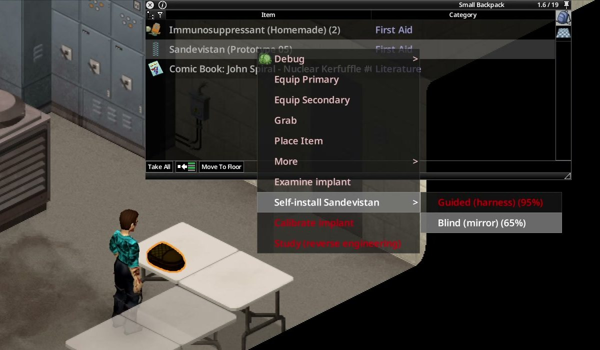

# Cirugía y crafteo

[Volver al contenido](README.md) · [English](../en/surgery-and-crafting.md) · [Русский](../ru/surgery-and-crafting.md)

Todo se hace desde menús de clic derecho o desde la pestaña **Sandevistan** del menú de crafteo. Las opciones que todavía no puedes
usar aparecen en gris, y su tooltip dice qué falta.

## Sin el nivel de la habilidad: los libros

Todo requisito de Primeros Auxilios, Electricidad, Soldadura o Costura de esta página se puede cubrir con los **libros de habilidad
del juego** de esa habilidad en el inventario. Con los libros la opción vuelve a estar disponible, pero tarda más y puede salir mal:
hace falta el libro de **cada nivel que te falta** (el volumen N enseña los niveles 2N−1 y 2N), y la penalización es menor cuanto más
cerca estés del nivel.

| Habilidad requerida | Tienes | Libros que necesitas |
|---|---|---|
| Primeros Auxilios 4 | PA 0 | Primeros Auxilios vol. 1 y 2 |
| Primeros Auxilios 4 | PA 2 | Primeros Auxilios vol. 2 |
| Primeros Auxilios 4 | PA 3 | Primeros Auxilios vol. 2 |
| Electricidad 5 | Elec 0 | Electricidad vol. 1, 2 y 3 |

- **Con el nivel requerido no hay ninguna penalización.**
- Los libros tienen que estar **en tu inventario** (las mochilas cuentan; un contenedor al lado no).
- Por debajo del nivel, las cirugías (instalar, explantar), reparar el Prototipo 04 y ensamblar el Prototipo 06 o el Mk. II usan una
  **probabilidad de éxito menor**: 8 puntos menos por nivel que falta en Normal, nunca menos de 25 % (45 % al explantar). Las cirugías
  además dejan la **herida profunda leve** aunque salgan bien. Calibrar y estudiar un diseño suman una **chance de fallar** (pierdes el
  material y nada cambia). Fabricar una parte o un chip con los libros también puede salir mal: se pierde el ítem y vuelve parte del
  material.
- El tooltip de la opción y el panel de crafteo dicen qué skill cubren los libros, cuántos niveles te faltan, cuánto más tarda y qué
  chance hay de que salga mal. Con el nivel, el panel de crafteo solo dice qué skill pide la receta.
- La **opción de sandbox *Guía con libros*** (Apagada / Suave / Normal / Dura) decide cuán dura es la penalización; la dificultad la
  elige por ti. En los presets nunca está apagada: es la forma de jugar solo.
- Los libros son ítems normales: se encuentran, se compran o se sacan de una biblioteca, y leídos siguen enseñando sus niveles.
- Cuando una acción pide dos habilidades (calibrar, reparar el Prototipo 04), los niveles que faltan de las dos **se suman**.
- Una parte fabricada con los libros sale con la **calidad de tu nivel real** (ver [calidad de las partes](#prototipo-06-réplica-de-laboratorio)):
  los libros te dejan fabricarla, no te hacen mejor.

Cuánto cuesta cada nivel que falta, según la opción de sandbox:

| *Guía con libros* | Tiempo extra | Probabilidad de éxito (cirugía, reparación, ensamblado) | Chance de que salga mal (calibrar, estudiar, fabricar) | Material que vuelve si falla un crafteo |
|---|---|---|---|---|
| Suave | +15 % por nivel | −5 puntos por nivel, nunca menos de 35 % | +6 % por nivel, hasta 40 % | 75 % |
| **Normal** | +25 % por nivel | −8 puntos por nivel, nunca menos de 25 % | +10 % por nivel, hasta 60 % | 50 % |
| Dura | +35 % por nivel | −10 puntos por nivel, nunca menos de 15 % | +14 % por nivel, hasta 75 % | 25 % |

Explantar siempre conserva su propio piso de 45 %, sea cual sea la opción.

## Instalar un implante

*Instalarlo en ti mismo: guiado con el arnés o a ciegas frente a un espejo, cada uno con su probabilidad de éxito.*

Clic derecho sobre el implante en tu inventario. Puedes instalártelo a ti o a otro jugador que esté a tu lado, que tiene que aceptar.
En todos los casos necesitas una **aguja de sutura** (o, como al coser una herida, una **aguja de coser e hilo** para 3 puntadas) y
**desinfectante** (o toallitas con alcohol). En las tablas, PA = Primeros Auxilios.

| Método | A quién | Además pide | Primeros Auxilios mínimo | Probabilidad de éxito |
|---|---|---|---|---|
| Guiada (arnés) | a ti | arnés aplicador | 4 | 75 % (95 % desde PA 6) |
| A ciegas (espejo) | a ti | espejo (ítem o frente a uno), bisturí, analgésicos | 7 | 65 % |
| Asistida con arnés | a otro jugador | arnés aplicador | 2 | 80 % (95 % desde PA 4) |
| Asistida sin arnés | a otro jugador | bisturí | 4 | 70 % (90 % desde PA 6) |

- El **Arnés aplicador quirúrgico** viene con los implantes militares (dentro del estuche criogénico) y con el rasgo Instalador de
  callejón. Sin arnés hay que ir a ciegas, y a ciegas hace falta un **espejo**: el ítem en el inventario, o un espejo del mundo justo al
  lado (lo mismo que mira el juego para maquillarte).
- **Por debajo del mínimo de Primeros Auxilios, con los libros:** la probabilidad del mínimo menos la penalización por nivel que falta.
  Por ejemplo, una cirugía guiada con Primeros Auxilios 2 y el vol. 2: 75 − 16 = **59 %** en Normal. La cirugía además deja la herida
  profunda leve.
- **Una cirugía fallida nunca pierde el implante.** Solo sale un poco más gastado (+0,1×) y puedes intentarlo de nuevo.
- Después de la cirugía sientes dolor. **Toma un inmunosupresor enseguida:** el aviso antes de operar te lo recuerda.
- **Carpeta de laboratorio del estudiante:** si el cirujano lleva la carpeta completa (5/5), cualquier método sirve para un implante de
  **laboratorio** desde Primeros Auxilios 1. La probabilidad es menor por debajo del mínimo de siempre (por ejemplo, 35 % para una
  cirugía a ciegas con PA 1), y aunque salga bien te queda una herida profunda leve en la espalda, que hay que coser y vendar.
- La primera vez que alguien recibe un implante, también recibe la **guía de campo**.

## Explantar un implante

Clic derecho en el suelo cerca de ti: explantar el tuyo o el de un jugador que esté a tu lado. Necesitas **bisturí y desinfectante**,
más un **espejo** si lo haces sobre ti. No hace falta aguja de sutura: la incisión queda abierta, así que véndala después.

- Primeros Auxilios **6** (70 %, 90 % desde PA 8). Un implante destruido pide Primeros Auxilios **7**.
- Con los libros de Primeros Auxilios por debajo de ese nivel la probabilidad baja, pero nunca de **45 %**, ni con PA 0.
- Siempre causa un sangrado fuerte y dolor, salga bien o mal. Si falla, el implante queda en su lugar.
- El implante que sale tiene +0,2× de desgaste.
- Conservas **toda** tu adaptación para el próximo implante (la mitad si el anterior estaba destruido). El siguiente arranca con 30 de
  rechazo.
- Razones para explantar: cambiar uno de laboratorio por uno militar, sacar un implante destruido, o empezar los 5 días de
  [remisión](your-body.md#remisión).

## Extraer un implante de un cuerpo

Algunos zombis llevan un implante (un **ex-sujeto**: se ve el implante brillando en su espalda). También lo lleva el cuerpo de
cualquier jugador que murió con uno. Clic derecho sobre el cuerpo:

- **Con bisturí:** una extracción limpia. El desgaste depende solo de tus Primeros Auxilios: 1,6× con PA 0, bajando hasta **1,0×
  (perfecto) con PA 4**.
- **Con cualquier cuchillo afilado** (de cocina, de caza, tijeras, machete...): una extracción tosca. Suma 0,2× más de desgaste, tarda
  el doble y tiene un 50 % de probabilidad de que te cortes la mano.
- Una extracción nunca deja el implante mejor de lo que estaba.
- Si el cuerpo de un ex-sujeto desaparece antes de que llegues, su implante queda en el suelo, con 1,5× de desgaste.
- Con **Project A-Life**, los NPCs vestidos con la espalda del Sandevistan también dejan un implante (militar 1,0×, laboratorio
  1,15×).

## Calibración

La calibración deja un implante gastado otra vez en 1,0×. Clic derecho sobre el implante suelto, o en el suelo para calibrar uno
instalado (el tuyo o el de un jugador cercano).

- Primeros Auxilios **4**, Electricidad **3** y un destornillador.
- **Chatarra electrónica:** 1 por cada 0,1× de desgaste que se saca (al menos 1).
- Con los libros, por debajo de cualquiera de los dos niveles, calibrar puede fallar (10 % por nivel que falta en Normal): se gasta la
  chatarra y el desgaste queda igual.

## Reparar un Prototipo 04

El Prototipo 04 es un implante de laboratorio defectuoso. Clic derecho → *Reparar Prototipo 04*.

- Electricidad **5**, Primeros Auxilios **4**, un destornillador, 2 de chatarra electrónica, una **Placa de interfaz neural**, una **Celda
  de energía** y una **Muestra de compuesto sintético**.
- Probabilidad según Electricidad: 60 % con 5, 85 % con 7. Con los libros por debajo del nivel: 8 puntos menos por nivel que falta
  (Electricidad y Primeros Auxilios juntos), nunca menos de 25 %. Por ejemplo, Electricidad 4 con el vol. 3 de Electricidad: **52 %**.
- Sale con 1,2× y nunca se puede calibrar por debajo de eso.
- Si falla pierdes el compuesto y la chatarra, y las partes vuelven más gastadas. El implante nunca se pierde.

## Recetas

Todas las recetas aparecen en la pestaña **Sandevistan** del menú de crafteo cuando las conoces.

| Receta | Ingredientes | Cómo se aprende |
|---|---|---|
| Compuesto sintético | mortero, 3 analgésicos, una compresa fría o bicarbonato, 0,1 L de alcohol, vodka o whisky | Cuaderno de laboratorio (síntesis), o el rasgo Aprendiz de ripperdoc |
| Inmunosupresor casero (3 dosis) | mortero, 2 analgésicos, 1 compuesto sintético, 0,1 L de alcohol | Cuaderno de laboratorio (síntesis), el rasgo Aprendiz de ripperdoc, o una opción de sandbox |
| Tintura herbal inmunosupresora | mortero, 2 ajos silvestres, 2 salvias negras o consueldas, 0,1 L de agua o alcohol | Cuaderno de laboratorio (síntesis), el rasgo Aprendiz de ripperdoc, Recolección 3 o el rasgo Herbolario |
| Black Lace casero (3 dosis) | 1 analgésico, 1 pastilla de cafeína, 0,1 L de alcohol | Informe de formulación del Black Lace, o el rasgo Ex-corpo |
| Chip de firmware virgen | destornillador, 3 de chatarra electrónica, 1 cable; **Electricidad 4** (o los libros) | lo sabe cualquiera que tenga (o haya tenido) un implante |

Para aprender de un cuaderno o un informe, **léelo** (como cualquier libro de habilidad).

## Fabricar tu propio implante

### Prototipo 06 (réplica de laboratorio)

**1. Aprende el diseño.** Clic derecho sobre un implante de laboratorio suelto (Prototipo 05 o 04) → *Estudiar*. Necesitas
**Electricidad 4**, un destornillador y la **Carpeta de laboratorio del estudiante completa** (5/5) en el inventario. Estudiar un
implante que funciona le suma +0,1× de desgaste. Aprendes las cinco partes, el ensamblado y los planos. Por debajo de Electricidad 4
con los libros, el estudio puede fallar (10 % por nivel que falta en Normal): desarmas el implante igual (+0,1× de desgaste) pero no
aprendes nada.

**2. Fabrica las cinco partes.** Cada una pide una sola habilidad, así en un servidor cada jugador se especializa y se pasan las
partes.

| Parte | Habilidad | Ingredientes (más un destornillador) |
|---|---|---|
| Placa de interfaz neural | Electricidad 5 | 4 de chatarra electrónica, 2 cables |
| Regulador térmico | Soldadura 4 | 2 chapas chicas o chatarra de metal, 1 cable, 2 de chatarra electrónica |
| Celda de energía | Electricidad 3 | 1 batería, 1 cable, 2 de chatarra electrónica |
| Chasis del implante | ninguna | 6 tornillos, 4 chapas chicas o chatarra de metal |
| Arnés de enlace neural | Costura 3 | aguja de coser, hilo o cordel, 2 tiras de cuero, 2 cables |

Por debajo de la habilidad de una parte igual puedes fabricarla con los libros (10 % por nivel que falta de que salga mal; en Normal
vuelve la mitad del material).

La **calidad de cada parte** depende del nivel de quien la fabrica: de 1,5× con nivel 0 a 1,0× con nivel 10. La Soldadura cuenta como
2 niveles más. El chasis siempre es 1,0×. Las partes que encuentras en el mundo son 1,3×. El implante terminado sale con el
**promedio** de sus partes, con un grado: Fino (hasta 1,05×), Bueno (1,2×), Estándar (1,35×) o Tosco.

**3. Ensambla.** *Fabricar Sandevistan Prototipo 06*: las cinco partes, 2 de chatarra electrónica, 1 compuesto sintético y un
destornillador. **Primeros Auxilios 4**: 50 % (75 % con PA 6, 90 % con PA 8), +10 % con la Carpeta de laboratorio del estudiante
completa. Por debajo de Primeros Auxilios 4 con los libros: 8 puntos menos por nivel que falta, nunca menos de 25 % (Primeros Auxilios
3 con el vol. 2: 42 %). Si falla pierdes la chatarra y el compuesto, y las partes vuelven un poco más gastadas. Puedes intentarlo de nuevo.

### Mk. II (réplica militar)

**1. Aprende el diseño.** Clic derecho sobre un **implante militar que funcione** → *Estudiar el diseño militar*. Necesitas
**Electricidad 6**, un destornillador y **los dos expedientes militares completos** en el inventario: el Expediente del investigador
(12/12) y el Expediente del guardia del depósito (3/3). Los expedientes no se gastan. Por debajo de Electricidad 6, los libros
funcionan igual que con el Prototipo 06: el estudio puede fallar.

**2. Fabrica las partes.**

| Parte | Habilidad | Ingredientes (más un destornillador) |
|---|---|---|
| Microchip de grado militar | Electricidad 7 | 12 de chatarra electrónica, 3 cables (o encuéntralo: es muy raro) |
| Retículo neural militar | Electricidad 7 | 6 de chatarra electrónica, 2 cables, 1 microchip militar |
| Regulador criogénico | Soldadura 5 | 2 chapas o chatarra de metal, 1 cable, 2 de chatarra electrónica, 3 compresas frías |
| Celda de energía de alta densidad | Electricidad 6 | 2 baterías, 2 cables, 2 de chatarra electrónica |
| Chasis militar reforzado | ninguna | 8 tornillos, 5 chapas chicas o chatarra de aluminio |
| Arnés neural blindado | Costura 5 | aguja de coser, hilo grueso o cordel, 3 tiras de cuero, 3 cables, 2 de chatarra electrónica |

**3. Ensambla.** *Fabricar Sandevistan Mk. II*: las cinco partes, 2 de chatarra electrónica, un destornillador y un estabilizador: un
**Autoinyector de Black Lace** o un Black Lace casero **lleno**. **Primeros Auxilios 6**: 55 % (75 % con PA 8, 90 % con PA 10). Por debajo de Primeros Auxilios 6 con los libros: 8 puntos menos por
nivel que falta, nunca menos de 25 % (Primeros Auxilios 5 con el vol. 3: 47 %). Las partes siguen las mismas reglas y la misma calidad
que las del Prototipo 06.

### Planos

Cuando conoces un diseño puedes ponerlo por escrito para enseñárselo a otro: *Redactar planos del Prototipo 06* (un bolígrafo o lápiz
y 3 hojas) o *Redactar planos de la réplica militar* (5 hojas). Quien **lee** los planos aprende el diseño, sin necesitar los
expedientes ni un implante para estudiar.

### Placa con nombre

Los implantes que fabricas (P06 y Mk. II) llevan una placa con nombre. Con el implante en el inventario (sin instalar), clic derecho →
*Ponerle nombre a la placa* y escribe hasta 16 caracteres (necesitas un bolígrafo). El nombre viaja con el implante en las cirugías y
se ve en el panel del HUD.
