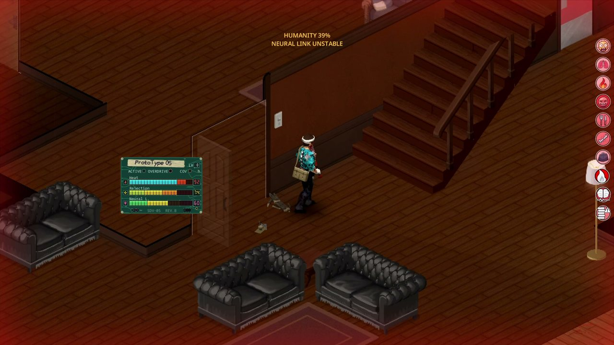

# Твоё тело

[К содержанию](README.md) · [English](../en/your-body.md) · [Español](../es/your-body.md)

Сам имплант никогда не ломается от перегрузки. Ломаешься **ты**. Следить нужно за четырьмя вещами: **отторжением**,
**иммунодепрессией**, **нейронагрузкой** и, если всё запустить, **киберпсихозом**.

## Отторжение

Тело воспринимает имплант как захватчика. Отторжение идёт от 0 до 100.

**Что его повышает:**

- Сам факт наличия импланта: **1,4 за игровой час** на уровне адаптации 0, линейно снижаясь до **нуля при стабильной адаптации**
  (уровень 5 у лабораторного, 7 у военного). Во сне растёт вдвое медленнее. Без лечения на уровне 0 доходит до 100 за
  **три-четыре дня** (тем быстрее, чем меньше ты спишь).
- Хроническая нейронагрузка: +0,3 в час, пока нейронагрузка 60 или выше, на любом уровне адаптации.
- События: термоотключение (+2–4, ничего при стабильной адаптации), коллапс после Овердрайва (+10–18, вдвое меньше при стабильной
  адаптации), смена прошивки (+3), сбой рефлекса (+3).
- Установка импланта после удаления другого начинается с 30.

**Что его снижает:**

- Иммуносупрессоры (следующий раздел).
- Само тело, медленно: при **выключенном** импланте, нейронагрузке ниже 60 и адаптации хотя бы 60 % от стабильной отторжение падает
  само (до 0,5 в час при стабильной адаптации, во сне быстрее). Под защитой иммуносупрессора оно падает с полной скоростью.

**Что оно делает:**

| Отторжение | Эффект |
|---|---|
| 35+ | Небольшая температура (37,4 °C), растущая вместе с отторжением: 37,8 на 50, 38,3 на 75, 38,8 на 90. |
| 75+ | Имплант нельзя включить, и ты не можешь уснуть. |
| 90+ | Оно будит тебя и начинает вредить (около 3 здоровья в час). |
| 100 | **Имплант разрушен.** Он выгорает и остаётся в позвоночнике, бесполезный. Чтобы установить другой, его нужно удалить операцией (Медицина 7), и ты сохраняешь только половину адаптации. |

Что меняет скорость: черта **Отторжение хрома** (×1,5), черта **Бегущий по краю** (стоимость событий ×1,5), полное **Досье
исследователя** (−15 %), прошивка **Совместимость** (−25 %) и множитель песочницы.

### Поддержка: таблетки дают время

Отторжение можно на время замедлить обычными таблетками, но они никогда не заменяют иммуносупрессоры:

| Таблетки | Что делают | Примечания |
|---|---|---|
| Обезболивающие | Отторжение растёт на 15 % медленнее 6 ч, и температура чуть ниже | Привыкание: каждая лишняя доза за 24 ч даёт вдвое меньше предыдущей |
| Снотворное | Гораздо меньше отторжения во сне (×0,35) и никаких ночных кошмаров | Можно спать до отторжения 89; действует 12 ч |
| Бета-блокаторы | Нейронагрузка за использование ×0,9, вдвое меньше криков и ночных кошмаров | 6 ч |

Они действуют, только когда **ты сам их принимаешь** (не когда обезболивающие тратит рецепт или операция). Настройка песочницы
*Поддержка (таблетки)* отключает всё это.

## Иммуносупрессоры

Они держат отторжение под контролем. В каждой единице **3 дозы**. Принимается через меню правой кнопки на предмете. Пункт меню
заранее показывает, что произойдёт: отторжение до и после, часы защиты и иммунодепрессия до и после.

| | Клинический | Самодельный | Травяная настойка |
|---|---|---|---|
| Защита | 48 ч | 24 ч | 8 ч |
| При приёме | отторжение до 0 | отторжение вдвое меньше | отторжение −25 % |
| Пока защищает | отторжение не растёт | отторжение не растёт | отторжение растёт на 25 % |
| Нейронагрузка за использование | −50 % | −35 % | −15 % |
| Побочные эффекты | нет | тошнота и 10 % шанс, что не сработает (отторжение вдвое меньше, без защиты) | +25 травяного отравления за дозу |
| Иммунодепрессия | +45 (минимум 50) | +30 (минимум 30) | +10 (минимум 10) |

- Защита от нескольких доз суммируется, максимум на **72 часа** вперёд.
- Пока ты под защитой, нейронагрузка **падает вдвое быстрее**.
- **Привыкание:** каждая лишняя доза за 24 часа даёт на 25 % меньше часов (до четверти).
- **Травяное отравление** уходит на 2,5 в час. С 50 тебя начинает тошнить.
- **Ударные дозы:** если накладывать дозы в пределах 24 часов, нейронагрузка от использования снижается ещё сильнее. С клиническими:
  50 %, затем 65 %, 75 % и максимум 80 %. Со второй дозы нейронагрузка ещё и падает в 1,5 раза быстрее. Цена — меньше часов защиты
  за дозу, больше иммунодепрессии и возможный **отскок отторжения** (см. ниже).

## Иммунодепрессия

Каждая доза ослабляет защиту организма. **Иммунодепрессия** идёт от 0 до 100, и у неё свой мудл (сломанный щит).

- Каждая доза её повышает (таблица выше). Пока ты под защитой, она не падает ниже **минимума** принятой дозы.
- Когда защита заканчивается, она падает сама: **4 в час бодрствуя, 6 во сне**. Если ты болен (заражённая рана, простуда или мудл
  болезни), она падает на 60 % от этой скорости, но не медленнее 2 в час.
- Вкладка «Имплант» показывает уровень, текущие эффекты и сколько осталось до 0.

**Что она делает** (на 100 при Нормальной, ниже — пропорционально меньше):

- Открытые раны без дезинфекции, чистой перевязки или антибиотиков **заражаются вдвое чаще**, а инфекция развивается вдвое быстрее.
- Раны заживают **в 1,6 раза медленнее**.
- Простуду ты ловишь вдвое легче, она бьёт вдвое сильнее, а выздоровление идёт в 1,5 раза медленнее.
- Испорченная еда и трупы делают тебя **в 1,5 раза больнее**.

Обычный уход по-прежнему работает: дезинфицируй, используй чистые бинты, принимай антибиотики, держись в тепле, спи.

**Отскок отторжения:** если курс доз поднял иммунодепрессию до 60 и выше, то после окончания защиты отторжение **6 часов растёт в
1,5 раза быстрее**. Заканчивай тяжёлый курс в безопасном месте.

Что её меняет: **Стойкий иммунитет** вдвое ослабляет эффекты и ускоряет спад. **Слабый иммунитет** — наоборот. **Ускоренное
заживление** и **Длительное заживление** меняют штраф к заживлению. Прошивка **Совместимость** снижает её на четверть. Настройка
песочницы задаёт Выкл., Слабую, Обычную или Жёсткую.

## Нейронагрузка

Нейронагрузка (0–100) — это цена, которую имплант берёт с твоего разума.

**Что её повышает:** только время с включённым имплантом (само включение ничего не стоит). Около **6 в минуту использования у
лабораторного и 9 у военного**, до снижений:

- адаптация: до −25 % при стабильной адаптации;
- защита иммуносупрессором: от −15 % до −50 % (до −80 % с ударными дозами);
- коллапс после Овердрайва: +5–10.

Она растёт быстрее при киберпсихозе (×2), с чертой **Склонность к киберпсихозу** (×1,25), после ремиссии (×1,25, навсегда) и с
прошивкой **Разгон**.

**Что её снижает:** отдых. Через **1 игровой час** без использования импланта она начинает падать, очень медленно: около 0,5 в час
ниже 30, 0,25 в час от 30 до 60 и 0,1 в час выше 60. Быстрее она падает под защитой иммуносупрессора (×2), с ударными дозами (×1,5)
и с антидепрессантами (×1,5). Медленнее — с чертой **Нейронестабильность**.

На практике минуты использования стоят дней отдыха. Пользуйся рывками.

**Симптомы с 60:** сбои экрана, носовые кровотечения, галлюцинации, предупреждения «нейромонитора» на экране, более быстрый Нагрев и
хроническое отторжение. С 60 во сне тебя могут разбудить с криком **ночные кошмары**. Иногда твой шум (удар, выстрел, дверь, шаги
бегом) **отзывается эхом через 5–20 секунд** откуда-то ещё, обычно сзади; при киберпсихозе это случается чаще. Слышишь его только ты,
и зомби оно не привлекает.

## Киберпсихоз

*Киберпсихоз: экран заливает красным, а имплант предупреждает, что нейросвязь нестабильна.*

На **нейронагрузке 80** начинается киберпсихоз. Он **не проходит, когда нагрузка падает**: единственный выход — ремиссия (ниже).
Если нагрузка опустится ниже 60, симптомы утихнут, но состояние останется, и они вернутся, когда нагрузка снова вырастет.

- **Временная нестабильность:** замедление сбоит, и ближайшие зомби на мгновение возвращаются к обычной скорости.
- **Чувство опасности:** слабые красные скобки отмечают ближайших зомби, которых ты не видишь (за стенами или углами). Некоторых из
  них на самом деле нет.
- **Слуховые галлюцинации:** шаги, стоны, удары, стекло, шёпот. Слышишь их только ты.
- **Галлюцинаторные сообщения:** время от времени внутри одного из искажающихся текстов (надписи, подсказки, строки чата)
  появляется короткая связная фраза и держится около двух секунд («ОБЕРНИСЬ», «ЭТО НЕ ТВОЁ», «КТО ГОВОРИТ?»), а остальной текст
  вокруг продолжает сбоить. Это локально, видишь только ты. Нужна включённая опция искажённого текста.
- **Психотическое давление:** усталость, боль или окружение зомби заставляют все галлюцинации приходить чаще (до 1,5 раза). Оно
  никогда не повышает нейронагрузку. Вкладка «Имплант» показывает его как низкое, среднее или высокое и что его повышает; отдых и уход
  от орды его снижают.
- **Якоря человечности:** сон в кровати, чтение книги или журнала, любимая еда и, в мультиплеере, время рядом с другим игроком
  **снижают давление** (не нейронагрузку) и отодвигают следующий кризис. У каждого свой откат. Высокий Нагрев тоже добавляет давление
  с 70 % от предела; после коллапса Овердрайва или полной ярости следующие 24 игровые минуты
  следующее предупреждение назначается с вдвое меньшим ожиданием.
- **Лёгкая ломка:** при нейронагрузке 60 и выше и **12 игровых часах без использования импланта** стресс и тоска медленно растут, а
  монитор настаивает. Она проходит сама через 48 часов (или если нагрузка упадёт ниже 60). 10 секунд использования её сбрасывают; в
  режиме работы засчитывается половина. Нейронагрузку она не трогает.
- **Психическое состояние:** вкладка «Имплант» собирает стадию и что она значит, насколько близок следующий кризис, рубец, окно
  уязвимости от Нагрева, последние записи чёрного ящика и уже обнаруженные галлюцинации (ложные зомби, которых ты коснулся или
  ударил, клон, маскировка, фантомные метки, фигуры на краю зрения).
- **Фигуры на краю зрения** (с дополнением галлюцинаций): время от времени тёмная полупрозрачная фигура на краю видимого, примерно в
  10 клетках, стоит и смотрит на тебя или медленно идёт. Она не издаёт звуков и не нападает. Посмотри прямо на неё или подойди — и
  она распадётся.
- **Приступы крика**, которые **привлекают** зомби.
- **Ярость:** с включённым имплантом ты бьёшь сильнее (+25 % к урону в ближнем бою и скорости атаки), не чувствуешь паники и меньше
  боли, но оружие изнашивается вдвое быстрее.
- Взвести Овердрайв труднее, а коллапс после него может убить (1 %).

**На 95 и выше:** имплант может **ложно срабатывать** — он сам включается на несколько секунд, когда на тебя нападает зомби. Также
бывают **провалы**: туннельное зрение, сердцебиение и мгновения темноты (двигаться можно). Изредка, с дополнением галлюцинаций,
случается **маскировка** на 20–40 секунд: зомби в поле зрения выглядят как люди (это всё ещё зомби, и они **по-настоящему кусают**),
а в мультиплеере другие игроки выглядят как зомби. Время от времени замаскированный на миг показывает, кто он на самом деле.

**Замаскированный ведёт себя как зомби** (мультиплеер, с дополнением галлюцинаций). Пока длится маскировка:

- Если он стоит, а ты подходишь, он **медленно поворачивается к тебе** примерно с 5 клеток; в пределах 2,5 клетки **поднимает руки** и
  стонет громче. Слышишь это только ты.
- Если он идёт, он перестаёт смотреть на тебя и снова ходит как обычно.
- Когда он впервые поднимает руки при каждом приближении, с шансом 35 % маскировка **срывается**: фигура бросается на тебя, как
  ложный зомби. Когда она касается тебя или ты её бьёшь, она распадается, и твой друг появляется там, где он на самом деле.
- **Он ничего этого не замечает**: не видит маскировки, не слышит стонов и не знает, когда она срывается.
- С включённым PvP (настройка *игроки тоже всегда в виде зомби*) он всё равно поворачивается, поднимает руки и стонет, но никогда не
  срывается.

Всё это **локально**: галлюцинации, ложные зомби, двойник и их звуки видны, слышны и отправляются только тебе, в том числе в
мультиплеере. Настоящие звуки импланта и доз по-прежнему слышат те, кто рядом.

**Кризисы:** время от времени кризис объявляет о себе за 20–40 секунд: нарастающий звон в ушах, туннельное зрение, сбоящий текст и
монитор, называющий то, что надвигается, — **паранойю** (гораздо больше ложных угроз примерно на минуту) или **диссоциацию** (время
сбоит, экран и текст глючат). С дополнением галлюцинаций и изометрической камерой во время эпизода мир теряет цвет, плывёт и
двоится, а с дополнением замедленного звука ближайшие звуки слегка расстраиваются. Провалы, ярость, перегрузка и скримеры трясут
камеру. Чтобы остановить кризис, прими **антидепрессант** или **сядь (или ляг спать), когда в 10 клетках нет зомби, на 8 секунд**.
Если эпизод уже начался, он пройдёт до конца, но сам по себе вреда не причиняет.

**Нейронный каскад:** с нейронагрузки 97 при включённом импланте монитор 20–30 секунд предупреждает о нейронном каскаде. **Выключи
имплант** за это время — и избежишь перегрузки (нагрузка останется на 99). Если нет, перегрузка наступит.

**Нейроперегрузка (100):** имплант отключается, и ты теряешь сознание на 8–15 секунд с носовым кровотечением, болью и криком,
который привлекает зомби. После этого нагрузка падает до 85. При киберпсихозе и рабочем импланте с шансом 30 % вместо этого
наступает **полная ярость**: 15 секунд с заклинившим включённым имплантом и ещё более сильными атаками, затем крах (нет выносливости,
короткая отключка, Нагрев на пределе и термический рубец 15).

**Галлюцинаторное пробуждение:** когда ты приходишь в себя после перегрузки (или короткой отключки в конце полной ярости), если
киберпсихоз ещё активен, наступают **60–90 секунд пика паранойи**: твой двойник рядом, один-два ложных зомби, ближайшие зомби в виде
людей и гораздо больше искажённого текста. Ты не знаешь, что реально, именно когда ты слабее всего.

**Нейронный рубец:** каждая перегрузка оставляет **2 очка рубца** (до 10). Каждое очко снижает **все** нейронные пороги на 1:
стадии, начало киберпсихоза и порог галлюцинаций. На 10 очках стадия 1 может начаться с 50, киберпсихоз — с 70, стадия 3 — с 85.
Каскад (97) и предел 100 не меняются. Восстанавливается **1 очко за игровой день с выключенным имплантом**.

**Чёрный ящик:** вкладка «Имплант» показывает **последний инцидент** (сколько времени назад и что это было: перегрузка, ярость,
избежанный каскад, предупреждение об отключении, эпизод, провал или ночной кошмар) и **сколько их было за 24 часа**.

### Ремиссия

Удали имплант и проживи **5 игровых дней без какого-либо импланта**. Первые 2 дня — ломка: стресс и усталость медленно растут
(антидепрессанты вдвое её ослабляют). После этого киберпсихоз заканчивается, а нейронагрузка не выше 50. Остаётся рубец: с этого
момента любой имплант добавляет нейронагрузку на 25 % быстрее. На пресете Жестокий ремиссии нет.

Когда ремиссия завершается, монитор пишет **ЧЕЛОВЕЧНОСТЬ ВОССТАНОВЛЕНА**, а клон появляется вдалеке, машет и медленно исчезает, без
сбоя. Если снова воспользуешься имплантом и сорвёшься, киберпсихоз вернётся сразу на стадии 3.

## Антидепрессанты

Обычные антидепрессанты помогают (правая кнопка → *Принять антидепрессант* или как обычно). Каждая доза действует 12 часов
(накапливается до 48). Пока она действует, нейронагрузка падает в 1,5 раза быстрее, симптомы приходят вдвое реже (галлюцинации,
сбои, крики, спонтанные носовые кровотечения), а отключка при перегрузке короче. Киберпсихоз они **не лечат**.

## «Чёрное кружево» (Керензиков)

Боевой препарат, отдельный от импланта. В каждой единице 3 дозы.

| | Автоинъектор (военный) | Самодельное |
|---|---|---|
| Длительность | 5 минут | 2,5 минуты |
| После | ничего | отходняк: усталость подскакивает до 65 %, выносливость падает до 30 % |

Длительность считается в реальном времени и не идёт, пока игра на паузе.

**Пока действует:** нет боли, паники и стресса, нет сонливости (она возвращается потом), действия стоят вдвое меньше выносливости,
прилив выносливости при уколе и восстановление каждую минуту, +20 % к скорости атаки и 25 % шанс, что зомби, бросающийся на тебя
вплотную, отшатнётся, не успев схватить.

**С Сандевистаном:** Нагрев растёт на 20 % медленнее. Пока имплант включён, его бонусы заменяют бонусы препарата. Не доводи
Овердрайв до коллапса под «Чёрным кружевом»: тебя вырубит, нейронагрузка вырастет в 1,5 раза больше, и пострадает сердце.

**Привыкание:** каждая лишняя доза за 24 часа действует на 25 % меньше (до половины).

**Как принимать:** из меню инвентаря или **повесь на пояс** и нажми клавишу панели быстрого доступа. Колоть можно на ходу. Бег
отменяет укол.
